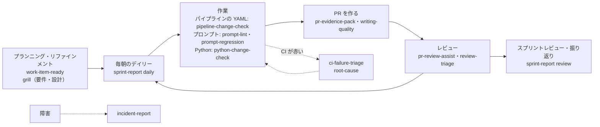

# dev-com

Windows の Codex で使う、持ち主専用の skill 18 個・custom agent 5 つ・AGENTS.md。
スクラム（1 週間スプリント）と Azure DevOps Server 2020（以下 ADO）での Work Item・PR・パイプラインの作業、プロンプトと Python の変更の確認、壁打ち、文章の作成、過去の会話の検索と振り返りを手伝う。
Python の標準ライブラリと Windows 標準の PowerShell だけで動く（会話の検索の意味の近さの検索だけ、任意で専用の環境を入れる）。

詳しい説明（動き方、skill ごとの説明、入れ方の細部、ADO への接続、評価の数字、前提にした事実、確かめていないこと）は [docs/notes.md](docs/notes.md)。

## 一覧

| 名前 | 種類 | 起動 | ADO | 使う場面 |
|---|---|---|---|---|
| [`ado`](docs/notes.md#ado) | skill | 自動 | 読む・書く | ADO に触れるすべての作業の土台。他の skill もこれに従う |
| [`sprint-report`](docs/notes.md#sprint-report) | skill | 自動 | 読む | デイリーの準備、スプリントレビューと振り返りの材料 |
| [`work-item-ready`](docs/notes.md#work-item-ready) | skill | 手動 | 読む・書く | プランニング・リファインメントの前、着手の直前 |
| [`pr-evidence-pack`](docs/notes.md#pr-evidence-pack) | skill | 手動 | 読む・書く | PR を作るとき |
| [`pr-review-assist`](docs/notes.md#pr-review-assist) | skill | 手動 | 読む・書く | 他人の PR のレビュー、自分の PR の出す前の確認 |
| [`ci-failure-triage`](docs/notes.md#ci-failure-triage) | skill | 自動 | 読む | CI が落ちたとき |
| [`pipeline-change-check`](docs/notes.md#pipeline-change-check) | skill | 自動 | 読む（展開の確認） | パイプラインの YAML を変えたとき |
| [`prompt-lint`](docs/notes.md#prompt-lint) | skill | 自動 | 使わない | プロンプト類を書いた・直した直後 |
| [`prompt-regression`](docs/notes.md#prompt-regression) | skill | 自動 | 使わない | プロンプト変更を PR にする前 |
| [`python-change-check`](docs/notes.md#python-change-check) | skill | 自動 | 使わない | Python を変更した後、PR の前 |
| [`incident-report`](docs/notes.md#incident-report) | skill | 手動 | 読む・書く | 障害の後のまとめ、ポストモーテム |
| [`grill`](docs/notes.md#grill) | skill | 手動 | 読む | 要件定義・設計・壁打ち。別の文脈の Codex と議論して合意を取る |
| [`review-triage`](docs/notes.md#review-triage) | skill | 自動 | 読む（頼めば返信） | PR に付いたレビュー指摘の採否を決めるとき。他の skill が指摘の裏を取るときにも使う（`grill` の議論は除く） |
| [`writing-quality`](docs/notes.md#writing-quality) | skill | 自動 | 使わない（頼めば送る） | PR 本文・Work Item・Teams・メール・設計文書を書く・直す・レビューするとき |
| [`code-comments`](docs/notes.md#code-comments) | skill | 自動 | 使わない | コードのコメントを書く・直すとき |
| [`root-cause`](docs/notes.md#root-cause) | skill | 自動 | 使わない | どのコミットで壊れたかを git bisect で探すとき |
| [`session-search`](docs/notes.md#会話の検索) | skill | 自動 | 使わない | 「前に〇〇って何て言ってた？」と過去の Codex の会話を探すとき |
| [`session-report`](docs/notes.md#会話のレポート) | skill | 自動 | 使わない | 1 つの会話や 1 週間分を、振り返り・スプリントレビュー・プランニング用の HTML にするとき |
| [`change-risk-reviewer`](docs/notes.md#change-risk-reviewer) | agent | `pr-review-assist` から | 使わない | 差分を独立した文脈で読むレビュアー |
| [`incident-evidence-analyst`](docs/notes.md#incident-evidence-analyst) | agent | `incident-report` から | 使わない | 障害のログを大量に読んで整理する |
| [`design-challenger`](docs/notes.md#design-challenger) | agent | `grill` から | 読む | 要件や設計の叩き台に反論する議論の相手 |
| [`prose-reviewer`](docs/notes.md#prose-reviewer) | agent | `writing-quality` から | 使わない | 文章を独立した文脈で判定するレビュアー |
| [`researcher`](docs/notes.md#researcher) | agent | 名指しされたとき | 使わない | 公式ドキュメントなど外の一次情報を大量に読んで、結論だけを返す |

「ADO: 読む・書く」の skill でも、書き込みはユーザーが頼んだときだけ行う。既定は下書きまで。

## スプリントの中での使いどころ

1 週間のスプリントの流れと、それぞれの場面で使う skill。実線はふだんの流れ、点線は CI が落ちたときや障害のときの寄り道。



| タイミング | 使うもの | 例 |
|---|---|---|
| 毎朝のデイリー前 | `sprint-report`（daily） | 「デイリーの準備をして」 |
| スプリントプランニング・リファインメント | `work-item-ready` | `$work-item-ready #1234 と #1235 を着手できる状態か見て` |
| 要件や設計を固めたいとき | `grill` | `$grill #1234 の retry の方針を詰めて` |
| 着手の直前 | `work-item-ready` | `$work-item-ready #1234 を始める前に足りないものを出して` |
| プロンプトを書いた・直した直後 | `prompt-lint` | 「変更したプロンプトを検査して」 |
| Python を変更した後 | `python-change-check` | 「この変更の検査を流して」 |
| パイプラインの YAML を変えた後 | `pipeline-change-check` | 「azure-pipelines.yml の変更で展開結果がどう変わるか見て」 |
| プロンプト変更の PR の前 | `prompt-regression` | 「このプロンプト変更で代表ケースが壊れていないか見て」 |
| PR を作るとき | `pr-evidence-pack` | `$pr-evidence-pack 今のブランチの PR を下書きして` |
| PR の本文やチャットの返信を書くとき | `writing-quality` | 「この PR の説明を、レビュアー向けに書き直して」 |
| レビューを頼まれたとき | `pr-review-assist` | `$pr-review-assist PR #123 をレビューして` |
| 自分の PR にレビューが付いたとき | `review-triage` | 「PR #123 に付いた指摘のどれを直すか決めて」 |
| CI が落ちたとき | `ci-failure-triage` | 「ビルド 4567 が落ちた原因を切り分けて」 |
| いつから壊れたか分からないとき | `root-cause` | 「このテストがどのコミットで落ちるようになったか bisect で探して」 |
| 前に何を決めたか思い出したいとき | `session-search` | 「前に CI の自動の再実行をどうするって決めたっけ？」 |
| 長い会話を振り返りたいとき | `session-report` | 「このセッションのレポートを作って」 |
| 振り返り・スプリントレビュー・プランニングの前 | `session-report`（週） | 「今週の振り返りのレポートを作って」。カンペにも使える |
| 障害の後 | `incident-report` | `$incident-report このログからポストモーテムを書いて` |
| 金曜のスプリントレビュー・振り返り前 | `sprint-report`（review） | 「今スプリントのまとめと振り返りの材料を出して」 |

## 入れ方

前提: Windows 10 / 11、Python 3.11（`python --version`。確かめているのは 3.11 だけ）、Codex。

1. このフォルダを会社 PC に置き、PowerShell で何が起きるかを見てから入れる。
   ```powershell
   powershell -NoProfile -ExecutionPolicy Bypass -File .\install.ps1 -WhatIf
   powershell -NoProfile -ExecutionPolicy Bypass -File .\install.ps1
   ```
   同じ名前の違うものがあれば上書きしない（`skipped`）。置き換えるときだけ `-Force`（元のものは `$HOME\.hirata-codex-backup\` に退避）。
2. ADO の Collection の URL をユーザーの環境変数に入れる（1 回だけ）。PAT で認証するときだけ `ADO_AUTH=pat` と `ADO_PAT`。**PAT はコマンドの引数やファイルに書かない。**
   ```powershell
   [Environment]::SetEnvironmentVariable('ADO_COLLECTION_URL', 'https://<サーバー>/tfs/<Collection>', 'User')
   ```
3. ターミナルと Codex を起動し直し、`/skills` に 18 個あることと、`/hooks` で `hirata-codex usage status` を信頼したことを確かめる。
4. Codex に「ADO に接続できるか確かめて」と頼む。

更新は新しいフォルダで `install.ps1 -Force`。GitHub のリポジトリの名前は 2026-10-18 に hirata-codex から dev-com へ変えた（古い URL は転送される）。入れた先の名前（`%LOCALAPPDATA%\hirata-codex`、`$HOME\.hirata-codex-backup`、フックの `hirata-codex usage status`、環境変数の `HIRATA_CODEX_*`）は、入れてある索引とフックの信頼を保つために変えていない。消し方とフックの細部は [docs/notes.md の「更新と削除」](docs/notes.md#更新と削除)。

## 利用枠

- 会社のアカウントの利用枠は Plus 相当で小さい。gpt-6-luna は gpt-6.1-sol の約 1/20 で済む。
- 依頼を受けると、Codex が勧めるモデルと effort を決め、今の設定と違えば止めて案内する（AGENTS.md の「モデルと effort の案内」）。
- skill ごとの勧める設定は各 SKILL.md の冒頭の「推奨の設定」の行。表は [docs/notes.md の「利用枠を節約する」](docs/notes.md#利用枠を節約する)。

## 困ったとき

[docs/notes.md の「うまくいかないとき」](docs/notes.md#うまくいかないとき) に、症状ごとの見るところの表がある。テストの流し方は [docs/notes.md の「テスト」](docs/notes.md#テスト)。
